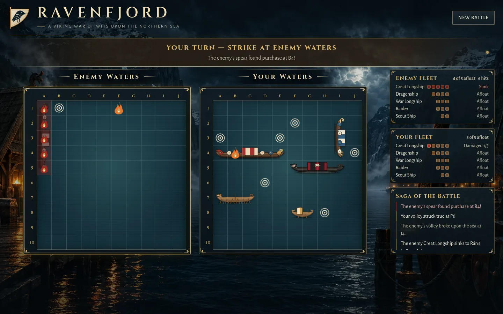

# Ravenfjord

**A Viking war of Battleship upon the northern sea.**

### [▶ Play Ravenfjord](https://ravenfjord.vercel.app)

Command a fleet of Norse longships against a computer-controlled jarl on the cold seas of the
north. The rules are classic Battleship. The look and feel are mist, fjords, weathered timber,
and bronze.



[Watch a 43-second playthrough](docs/assets/ravenfjord-gameplay.mp4) recorded on the live site.

See [docs/PROJECT_PLAN.md](docs/PROJECT_PLAN.md) for the requirements and rules specification.

## How to play

The dismissible **How to Play** guide opens on your first visit. Choose **How to Play** in the
header to open it again.

1. **Muster your fleet.** Choose a vessel, then click or tap your waters to moor it. Press
   <kbd>R</kbd> or **Rotate Ship** to turn it, drag a moored ship to reposition it, or click a
   moored ship to lift it back. **Auto-Place Fleet** arranges all five for you. Ships must stay on
   the board and may not overlap; they may touch.
2. **Start Battle** once all five are placed: Great Longship (5), Dragonship (4), War Longship (3),
   Raider (3), Scout Ship (2).
3. **Strike.** Click or tap a square in enemy waters. You fire first, and turns alternate one shot
   each. A hit does not earn another shot. Squares already fired on can't be chosen again.
4. A sunk enemy ship is revealed. The first side to sink the whole enemy fleet wins.
   **New Battle** starts over at any time.

Use **Sound: On/Off** in the header for optional ambient music and hit/sink effects. Sound is off by
default. The game is fully keyboard playable: Tab to a board, use the arrow keys to move, and press
Enter to place or fire.

## Computer opponent and battle feedback

The computer uses a hunt-and-target strategy: it searches for ships, then prioritizes neighboring
squares after a hit and continues along a known ship line. It sees only its own shot results and
the remaining ship lengths, never hidden ship positions.

Misses create water splashes and ripples; hits burst into embers and leave a flame marker. Sunk
ships are revealed and take on a burnt, darkened appearance. Animations respect
`prefers-reduced-motion`. Victory and defeat screens show shots fired, hits, accuracy, enemy ships
sunk, and ships lost.

## Visual assets

The harbour backdrop is original art generated from a text prompt without reference images; its
1536×1024 PNG master is not committed. The app ships 1920px AVIF (140,781 bytes) with WebP fallback
(185,926 bytes), and 960px AVIF (47,290 bytes) with WebP fallback (67,362 bytes), encoded by
`scripts/art/encode-backdrop.py`. See [art provenance](docs/ART_PROVENANCE.md) for the prompt and
details. The previous procedural generator, `scripts/art/generate-fjord.py`, is kept for reference.
The raven emblem is a hand-authored inline SVG inspired by the historical Viking raven banner.

## Known limitations

- Refreshing starts a new game; progress is not saved.
- The game runs entirely in the browser, so a player using developer tools could inspect the enemy
  fleet in memory; preventing that would need a server.
- Tested in Chromium at desktop, tablet and phone sizes; not on physical devices or in Safari or Firefox.

## Tech stack

- React 18 + TypeScript, built with Vite
- Plain CSS with design tokens. Ship art is hand-built inline SVG, and fonts (Cinzel, Alegreya Sans, both OFL) are bundled locally.
- Vitest + React Testing Library for unit and component tests
- Playwright for browser-level tests
- GitHub Actions CI: lint, format, typecheck, unit tests, build, browser tests

## Running locally

Requires Node.js 20+.

```bash
npm ci
npm run dev          # http://localhost:5173
```

## Testing

```bash
npm test             # unit + component tests (Vitest)
npx playwright install chromium   # first time only
npm run test:e2e     # browser tests against a production-style build
npm run lint && npm run typecheck
```

## Deployment

Vercel builds and deploys `main` to https://ravenfjord.vercel.app on every merge, using the Vite
preset with no extra configuration.

## Building

```bash
npm run build                                   # outputs dist/ for a root domain
BASE_PATH=/fleet-command-battleship/ npm run build   # for a GitHub Pages project subpath
```

## Documentation

- [Project plan](docs/PROJECT_PLAN.md): requirements, rules specification, architecture, milestones
- [Debugging summary](docs/DEBUGGING_SUMMARY.md): the five most instructive bugs, in about two pages
- [Debugging report](docs/DEBUGGING_REPORT.md): all 12 verified defects with root cause, fix, and verification
- [Interview debrief](docs/INTERVIEW_DEBRIEF.md): speaking notes for the project debrief
- [M1 submission](docs/M1_SUBMISSION.md): the three required links, release status and checklist
- [Third-party notices](docs/THIRD_PARTY_NOTICES.md): font and library licenses
